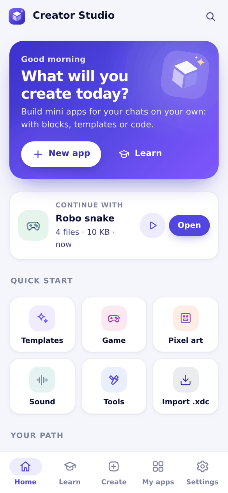
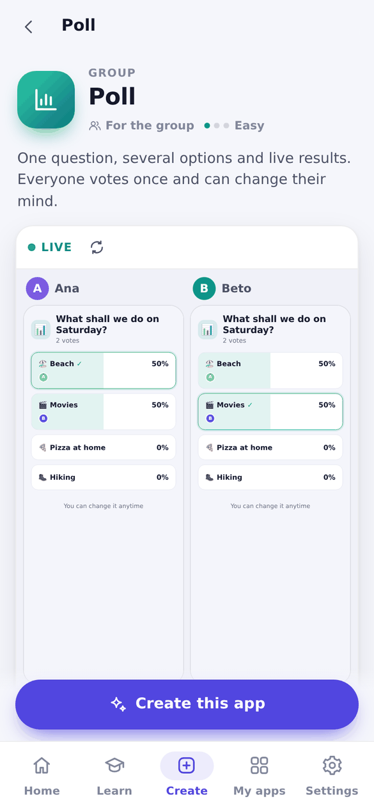
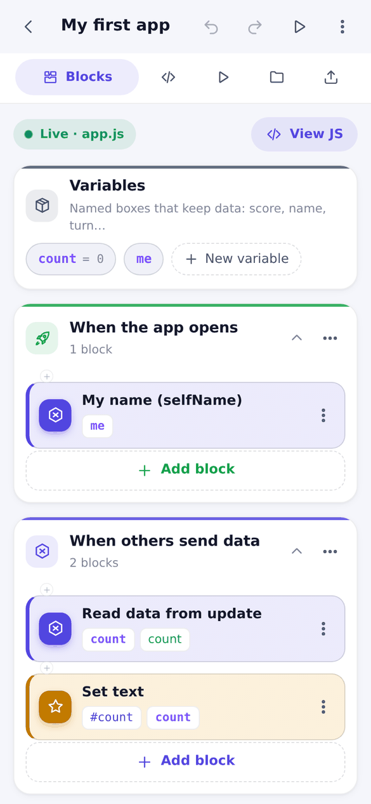
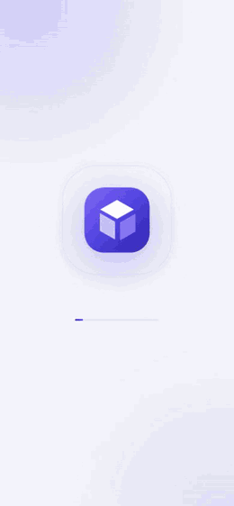
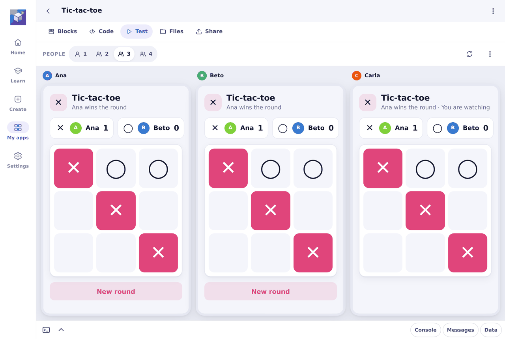

# Webxdc Creator Studio

Make your own [webxdc](https://webxdc.org) mini apps from inside [Delta Chat](https://delta.chat), with or without code. Pick a template, change it with visual blocks or a real code editor, try it with several people at once, and share it in a chat. Everything runs offline, on your phone.

<p align="center">
  
  
  
  
</p>

<p align="center">
  <a href="docs/TOUR.md"><b>Visual tour</b></a> ·
  <a href="docs/TOUR.es.md"><b>Tour visual en español</b></a>
</p>

| | |
|---|---|
| **Version** | 3.0.0 |
| **Languages** | English, Español |
| **License** | MIT |
| **Runtime dependencies** | none |

## Download

Every release ships two builds of the same app:

| File | Size | For |
|---|---|---|
| **creator-studio.xdc** | ~0.8 MB | Everyone. Light to send and receive. |
| **monaco-creator-studio.xdc** | ~1.9 MB | Tablets and computers: adds the optional Monaco editor. |

Send the file in any chat and tap **Start**. It updates in place over 2.x: projects, history and settings are kept.

## See it in action

<p align="center">
  
  
  
</p>
<p align="center"><sub>Tour (<a href="docs/media/en/clip-tour.mp4">MP4</a>) · From template to a two-player game (<a href="docs/media/en/clip-play.mp4">MP4</a>) · Studio (<a href="docs/media/en/clip-studio.mp4">MP4</a>)</sub></p>

<p align="center">
  
</p>
<p align="center"><sub>The Test tab runs your app as up to four people. Here Ana and Beto play while Carla watches.</sub></p>

## What's inside

**Create**
- 20 ready-made apps in five groups (games, group, organize, tools, creative), each with a live two-phone preview and simple fields to make it yours before creating it.
- Three starters (blocks, code, game) and a short wizard that suggests what to build.

**Build**
- **Blocks:** 313 blocks in 24 categories, written to readable JavaScript as you go. Includes a game engine for 2D, 3D and pixel games.
- **Code:** CodeMirror 6 with a suggestion strip above the phone keyboard, a symbol bar, explanations for what you type, 30 ready components and calm error hints. Monaco is optional in the larger build.
- **Test:** run the app as one to four people, with simulated delay and lost messages.
- **Share:** checks before sending, the app icon, and export as `.xdc`.

**Studio**
- Pixel art with layers, frames and GIF export; a photo editor; a sound maker with 12 effect presets and a four-track music editor.

**Tools**
- Color and contrast, gradients, shadows, an icon maker (512 px), QR codes, JSON, regular expressions, encoding and sample data.

**Learn**
- 20 interactive lessons in five tracks, with live playgrounds, levels and medals; a searchable reference, glossary and troubleshooting guide.

**Projects**
- Automatic and manual version history, backups and `.xdc` import. Limits: 300 files and 24 MB per project.

## Build from source

```bash
python3 build.py            # creator-studio.xdc, monaco-creator-studio.xdc, demo/creator-studio-demo.html
python3 build.py --stage    # unpacked build in .stage/ for local testing
```

Only Python 3 is needed. Builds are reproducible: the same sources give the same bytes.

## Tests

```bash
npm install                 # playwright-core (uses a local Chromium; set CHROMIUM_PATH if needed)
npm test                    # engines: color, QR, raster, audio, zip, blocks, every template in both languages
npm run test:e2e            # every screen in both languages, templates with two peers, update from 2.x
npm run test:artifact       # both .xdc packages, including a real Monaco start
```

The update test replays storage captured from the published 2.0 app (`tests/fixtures/v2-storage.json`).

## Repository layout

```
src/
  index.html  manifest.toml  icon.png  modules.txt   load order; build.py writes the script tags
  kernel/     namespace, DOM helpers, settings, router, i18n, icons, UI components, keyboard
  data/       storage (IndexedDB with fallbacks), projects, history, import and export
  engines/    blocks, game engine, zip, simulator, checker, editors, color, QR, raster, audio
  features/   home, create, projects, workspace, studio, learn, tools, settings
  templates/  the 20 apps and the starters
  locales/    English and Spanish strings
  styles/     design tokens and feature styles, joined into app.css
  vendor/     CodeMirror 6 bundle and Monaco
tests/        unit.js  e2e.js  artifact.js  fixtures/  mock-webxdc.js
tools/cm/     rebuilds the CodeMirror bundle
tools/icon.svg  source of src/icon.png (rendered at 512 × 512)
docs/         visual tour (English and Spanish), changelog, compatibility, limitations, store listing
  media/      screenshots and clips used by the README and the tour
```

A webxdc app is a ZIP file with the `.xdc` extension and `index.html` at its root. The messenger provides `webxdc.js`, so it is never packaged.

## Documentation

- [Visual tour](docs/TOUR.md) · [Tour visual](docs/TOUR.es.md)
- [Changelog](docs/CHANGELOG.md)
- [Compatibility](docs/COMPATIBILITY_MATRIX.md)
- [Known limitations](docs/KNOWN_LIMITATIONS.md)
- [Store listing](docs/STORE_SUBMISSION.md)
- [Contributing](CONTRIBUTING.md) · [Security](SECURITY.md)
- webxdc specification: [webxdc.org/docs](https://webxdc.org/docs/)

## License

[MIT](LICENSE). CodeMirror © Marijn Haverbeke and others (MIT, `src/vendor/LICENSE-codemirror.txt`). Monaco Editor © Microsoft (MIT, `src/vendor/monaco/LICENSE-monaco.txt`).
