# Tour visual

Un recorrido por Webxdc Creator Studio 3.0, pantalla a pantalla. Todas las capturas salen de la app real, ejecutada con el mismo webxdc simulado que usan las pruebas. [English version](TOUR.md)

  
  
  

Recorrido (<a href="media/es/clip-tour.mp4">MP4</a>) · De la plantilla a un juego para dos (<a href="media/es/clip-play.mp4">MP4</a>) · Estudio (<a href="media/es/clip-studio.mp4">MP4</a>)

## 1. Inicio

  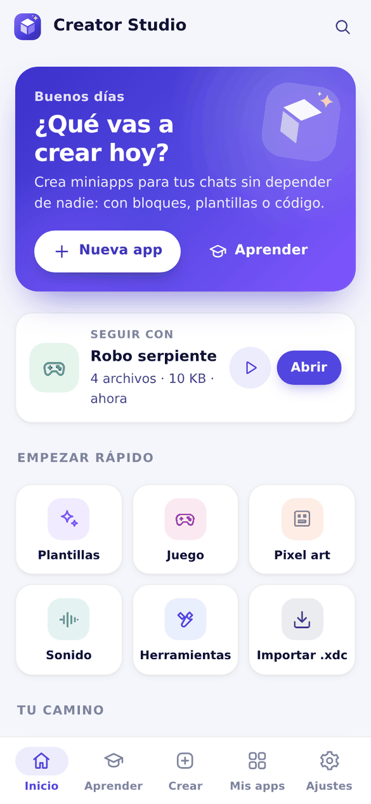
  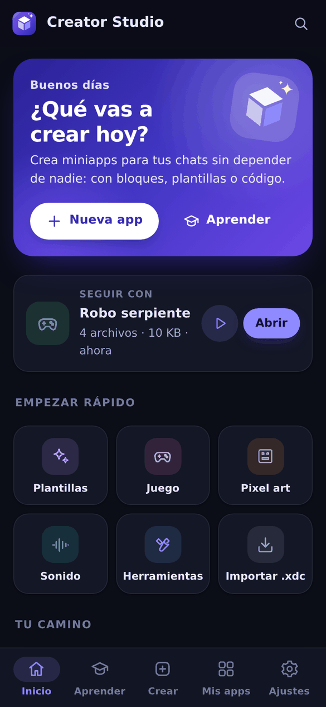

La pantalla de inicio responde a una sola pregunta: ¿qué vas a crear hoy? Empieza una app nueva, sigue con el último proyecto, salta a plantillas, juegos, pixel art, sonidos o herramientas, o continúa con la siguiente lección. Los temas claro y oscuro siguen al dispositivo, y hay tres tamaños de letra.

## 2. Crear

  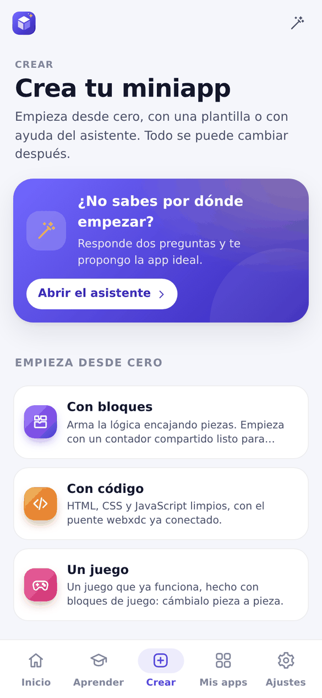
  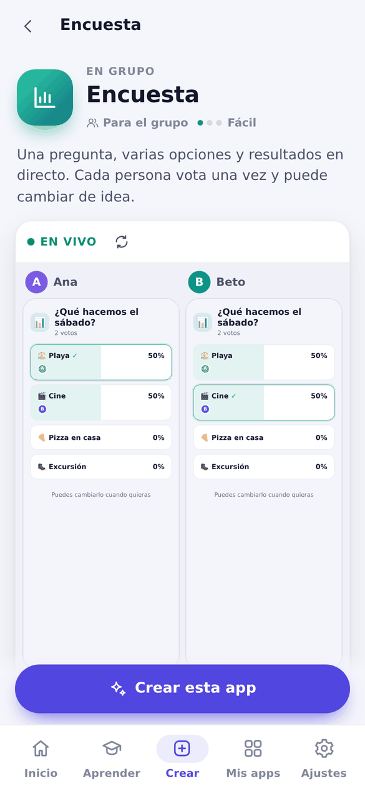

Empieza desde cero (con bloques, con código o con un juego), responde dos preguntas en el asistente o elige una de las 20 apps listas. Cada plantilla se abre con una **vista previa en vivo para dos personas**: aquí Ana y Beto votan en la misma encuesta y los dos teléfonos se actualizan a la vez. Cambia el título, los colores y las opciones antes de crearla; la app se escribe en el idioma de Creator Studio.

## 3. Construir con bloques o con código

  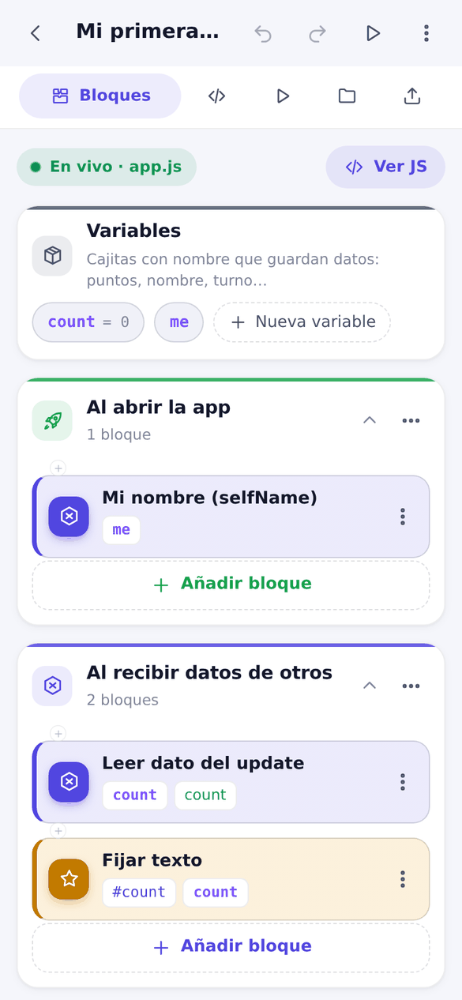
  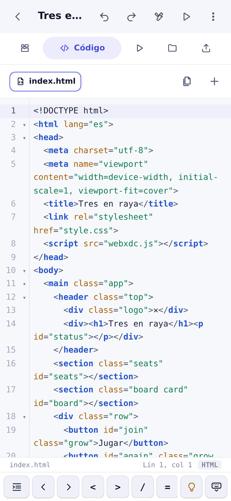

Los **bloques** se leen como frases: *al abrir la app*, *al recibir datos de otros*, *fijar texto*. Las variables son cajas con nombre, y cada bloque se convierte en JavaScript legible sobre la marcha (toca **Ver JS**). Si editas ese archivo a mano, los bloques se pausan en lugar de borrar tu trabajo.

El **código** usa CodeMirror 6 con sugerencias encima del teclado del teléfono, una barra de símbolos, explicaciones en lenguaje sencillo y 30 componentes listos. La versión grande añade el editor Monaco.

## 4. Probar con varias personas

  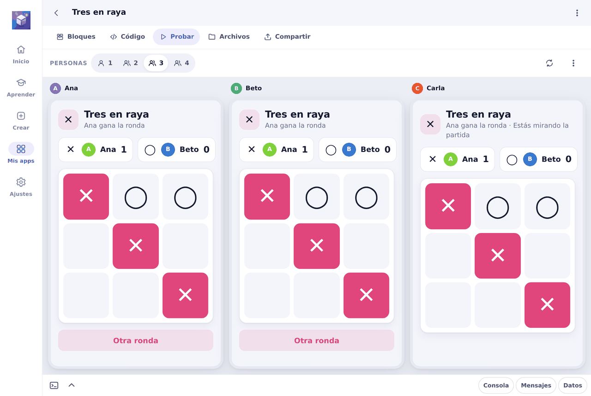

  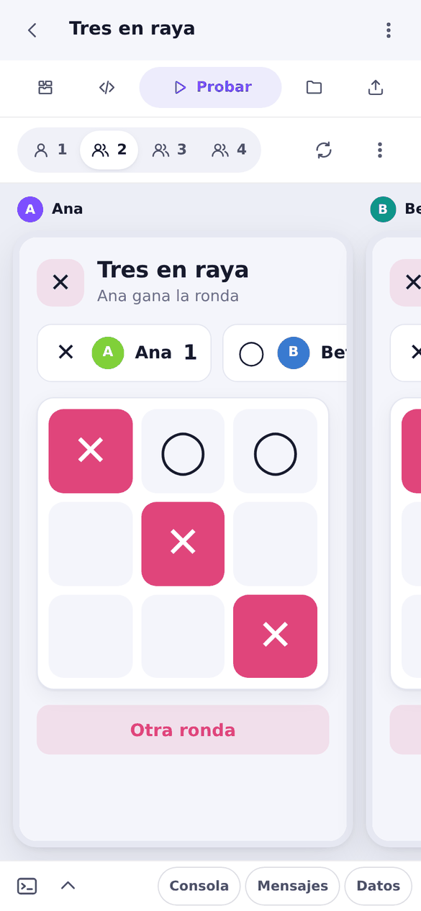

Ejecuta la app como si fueran de una a cuatro personas. Cada teléfono es una copia aislada con su propio nombre, y las actualizaciones viajan entre ellos igual que en un chat, incluidas las tuyas. En la computadora los teléfonos aparecen uno al lado del otro; en el teléfono se pasa de uno a otro deslizando. Añade retardo o mensajes perdidos para ver cómo se comporta la app en una red real, y revisa la consola, los mensajes y los datos guardados en el panel inferior.

## 5. Estudio

  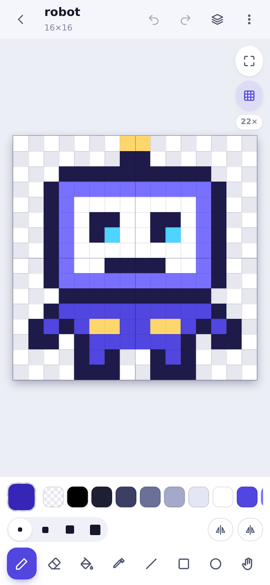
  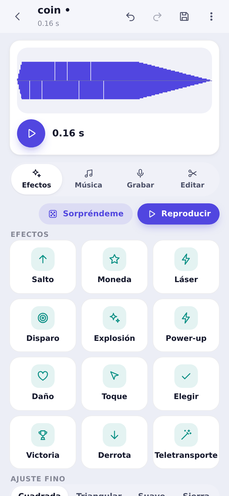

Crea los recursos de tu app sin salir de ella: **pixel art** con capas, fotogramas y exportación a GIF, un **editor de fotos** y un **creador de sonidos** con 12 efectos predefinidos, el botón *Sorpréndeme* y un editor de música de cuatro pistas. Todo se guarda en el proyecto, listo para bloques o código.

## 6. Aprender

  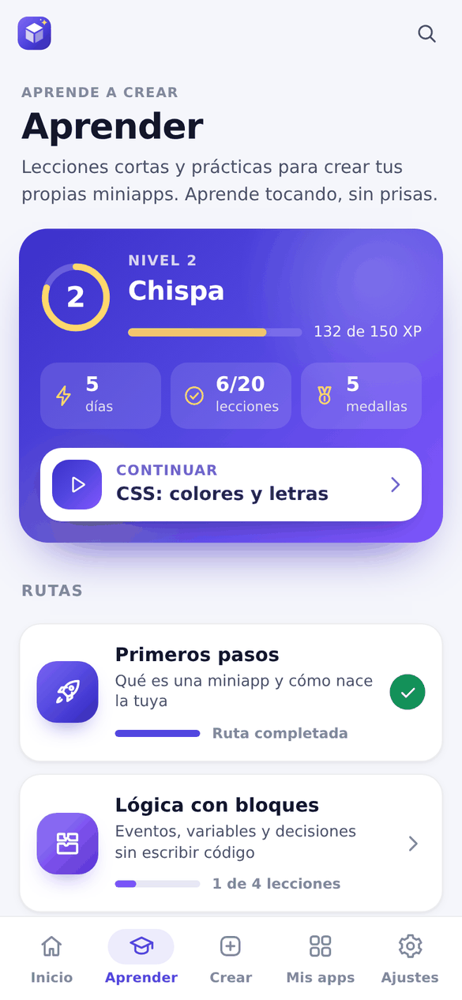
  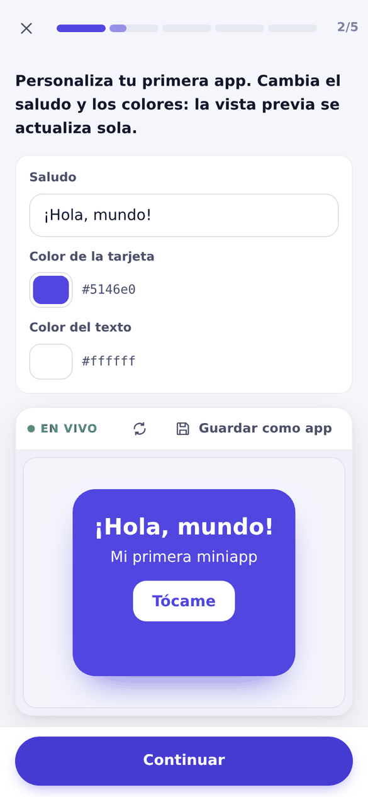

20 lecciones cortas en cinco rutas: *Primeros pasos*, *Diseño: HTML y CSS*, *Lógica con bloques*, *Código JavaScript* y *Apps para compartir*. Mezclan lectura, preguntas, ordenar, completar y unir con **prácticas en vivo** donde cambias una app real y la ves actualizarse. Los niveles, las rachas diarias y las medallas lo hacen divertido. La referencia con buscador, el glosario y la guía de problemas están siempre a un toque.

## 7. Herramientas

  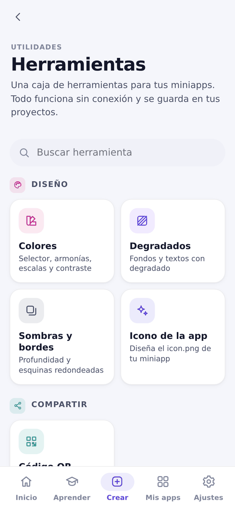

Una pequeña suite dentro del estudio: colores con contraste accesible, degradados, sombras, creador de iconos, códigos QR, JSON, expresiones regulares, codificación y datos de ejemplo. Los resultados se copian o se guardan directamente en un proyecto.

## 8. Compartir

Cuando la app está lista, **Compartir** la revisa en lenguaje sencillo (archivos que faltan, llamadas a internet que no funcionan en un chat, un icono ausente), ofrece arreglos de un toque y envía el `.xdc` a un chat o lo descarga.

---

Las imágenes de esta página se generan desde la propia app; los cambios de la 3.0 están en el [CHANGELOG](CHANGELOG.md).
