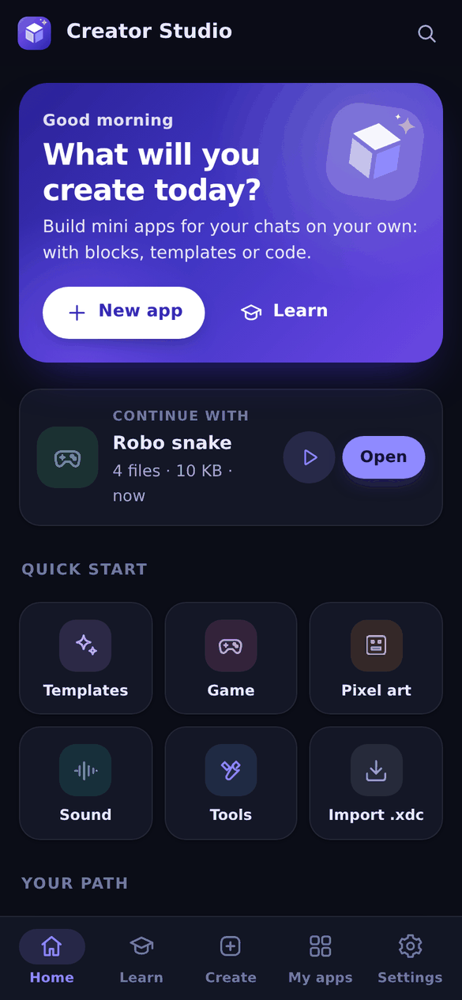
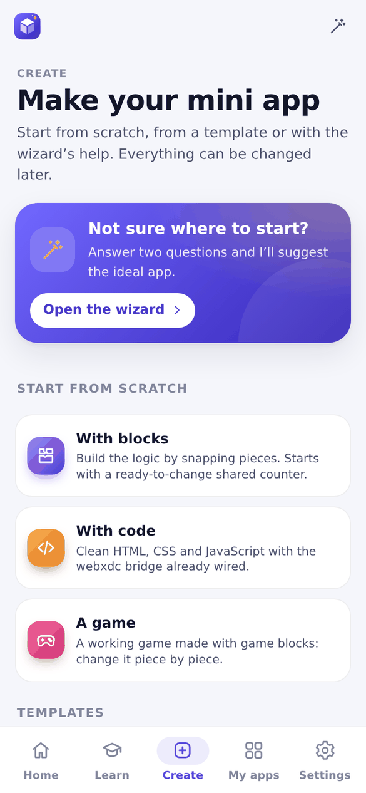
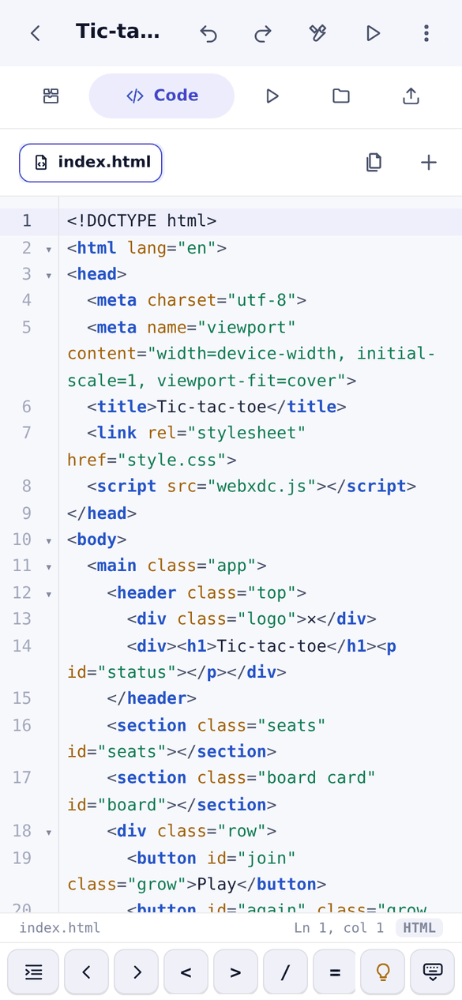
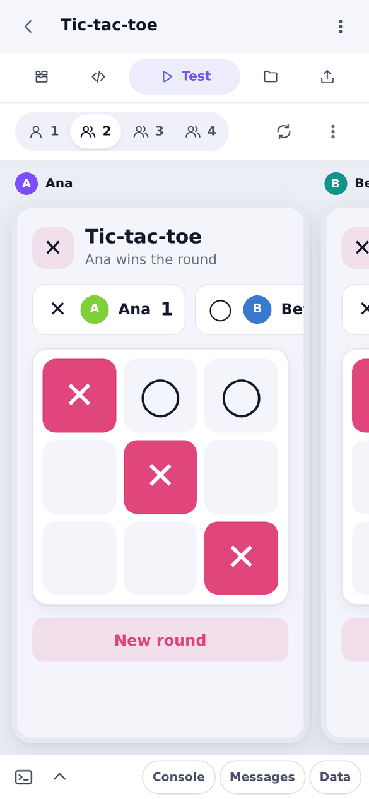
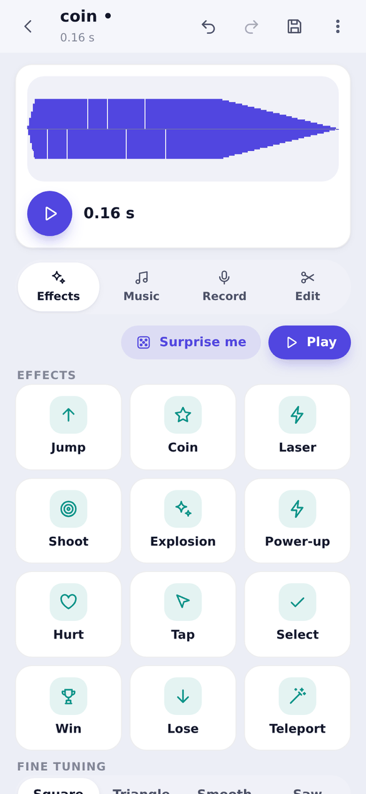
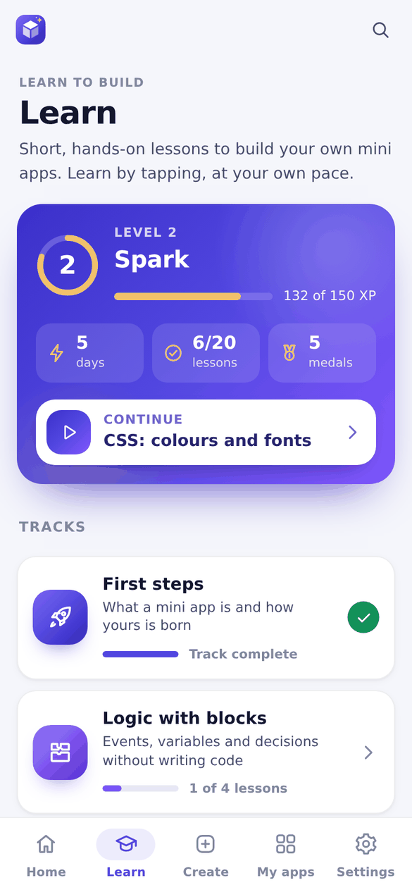
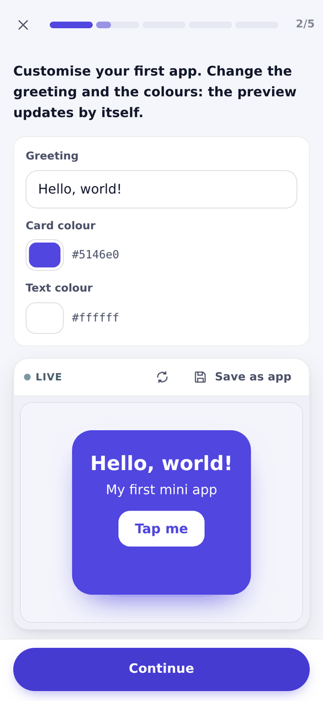
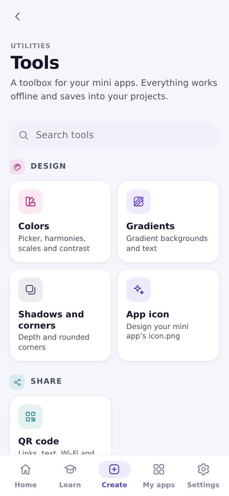

# Visual tour

A walk through Webxdc Creator Studio 3.0, screen by screen. All captures come from the real app running with the same webxdc stand-in the tests use. [Versión en español](TOUR.es.md)

  
  
  

Tour (<a href="media/en/clip-tour.mp4">MP4</a>) · From template to a two-player game (<a href="media/en/clip-play.mp4">MP4</a>) · Studio (<a href="media/en/clip-studio.mp4">MP4</a>)

## 1. Home

  
  

The start screen answers one question: what will you create today? Start a new app, continue the last project, jump to templates, a game, pixel art, sounds or tools, or follow the next lesson. Light and dark themes follow the device, and there are three text sizes.

## 2. Create

  
  

Start from scratch (blocks, code or a game), answer two questions in the wizard, or pick one of 20 ready apps. Each template opens with a **live preview for two people**: here Ana and Beto vote in the same poll and both phones update at once. Change the title, colors and options before creating it; the app is written in the language Creator Studio uses.

## 3. Build with blocks or code

  
  

**Blocks** read like sentences: *when the app opens*, *when others send data*, *set text*. Variables are named boxes, and every block turns into readable JavaScript as you go (tap **View JS**). If you edit that file by hand, the blocks pause instead of overwriting your work.

**Code** uses CodeMirror 6 with suggestions above the phone keyboard, a symbol bar, plain-language explanations and 30 ready components. The larger build adds the Monaco editor.

## 4. Test with several people

  

  

Run the app as one to four people. Every phone is an isolated copy with its own name, and updates travel between them exactly as they would in a chat, including your own. On a computer the phones sit side by side; on a phone you swipe between them. Add delay or lost messages to see how the app behaves on a real network, and read the console, messages and stored data in the drawer below.

## 5. Studio

  
  

Make the assets for your app without leaving it: **pixel art** with layers, frames and GIF export, a **photo editor**, and a **sound maker** with 12 effect presets, a *Surprise me* button and a four-track music editor. Everything is saved into the project, ready for blocks or code.

## 6. Learn

  
  

20 short lessons in five tracks: *First steps*, *Design: HTML and CSS*, *Logic with blocks*, *JavaScript code* and *Apps to share*. Lessons mix reading, quizzes, ordering, fill-in and matching with **live playgrounds** where you change a real app and watch it update. Levels, daily streaks and medals keep it fun. A searchable reference, a glossary and a troubleshooting guide are always one tap away.

## 7. Tools

  

A small suite inside the studio: colors with accessible contrast, gradients, shadows, an app icon maker, QR codes, JSON, regular expressions, encoding and sample data. Results can be copied or saved straight into a project.

## 8. Share

When the app is ready, **Share** checks it in plain language (missing files, network calls that cannot work in a chat, a missing icon), offers one-tap fixes, and sends the `.xdc` to a chat or downloads it.

---

The media in this page is generated from the app itself; see [CHANGELOG](CHANGELOG.md) for what changed in 3.0.
